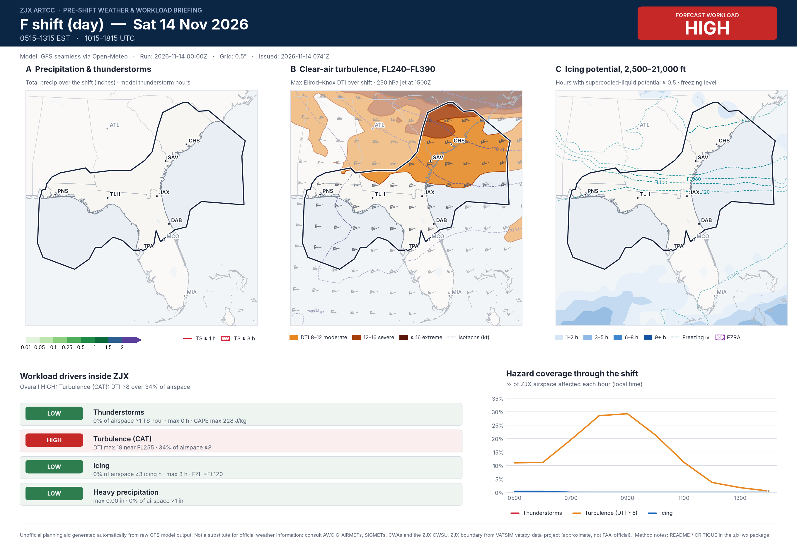
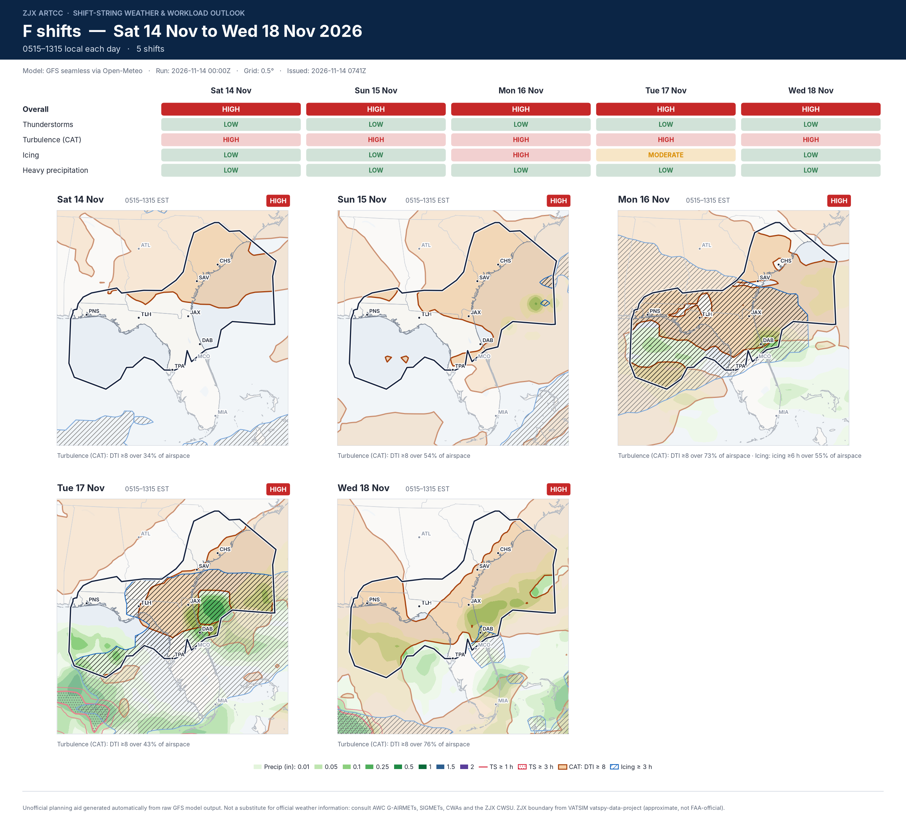
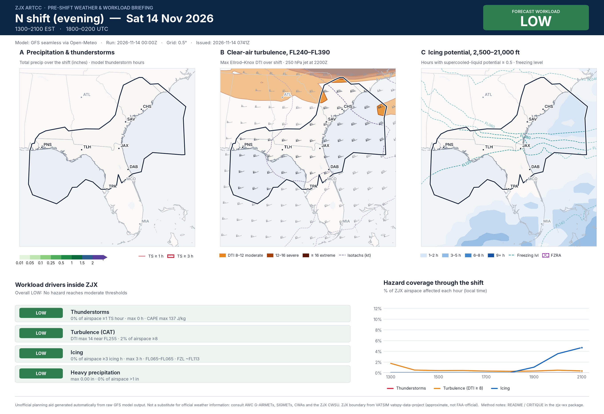
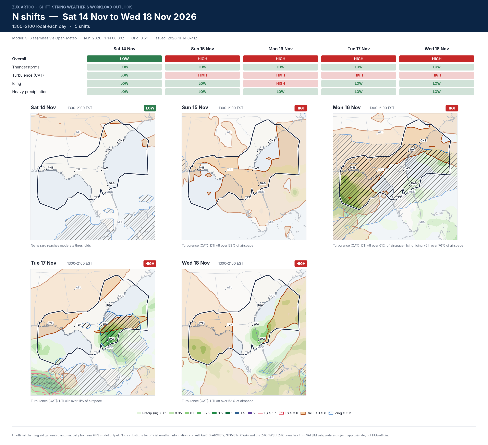
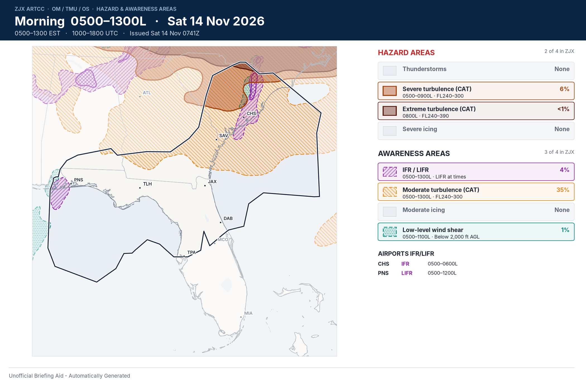
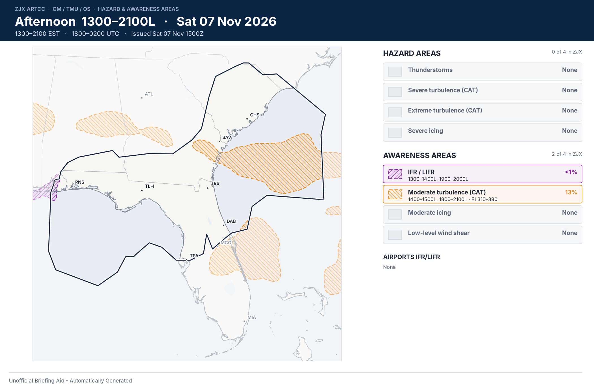
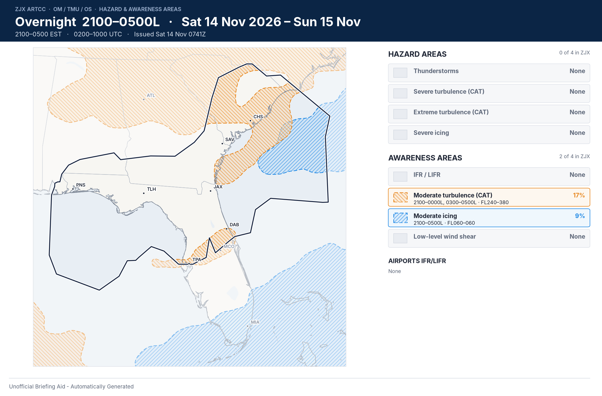

# ZJX pre-shift weather & workload briefings

Latest images: see the GitHub Pages site. Updated 2026-11-14 0741Z.

## F shift, 2026-11-14: **HIGH**

Turbulence (CAT): DTI ≥8 over 34% of airspace

## N shift, 2026-11-14: **LOW**

No hazard reaches moderate thresholds

## OM/TMU/OS

### Morning 0500–1300 EST

Hazard: Severe turbulence (CAT), Extreme turbulence (CAT)  
Awareness: IFR / LIFR, Moderate turbulence (CAT), Low-level wind shear

### Afternoon 1300–2100 EST

Hazard: none  
Awareness: IFR / LIFR, Moderate turbulence (CAT), Moderate icing

### Overnight 2100–0500 EST

Hazard: none  
Awareness: Moderate turbulence (CAT), Moderate icing

