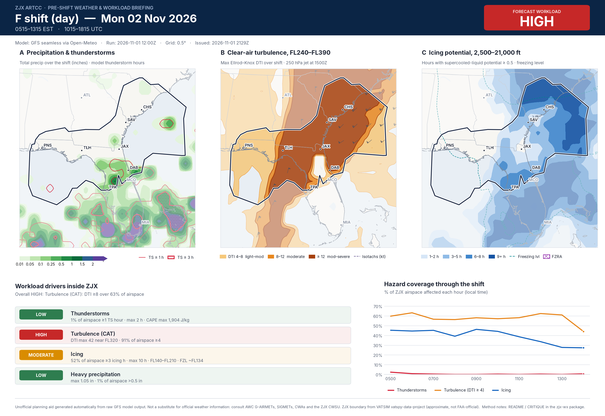
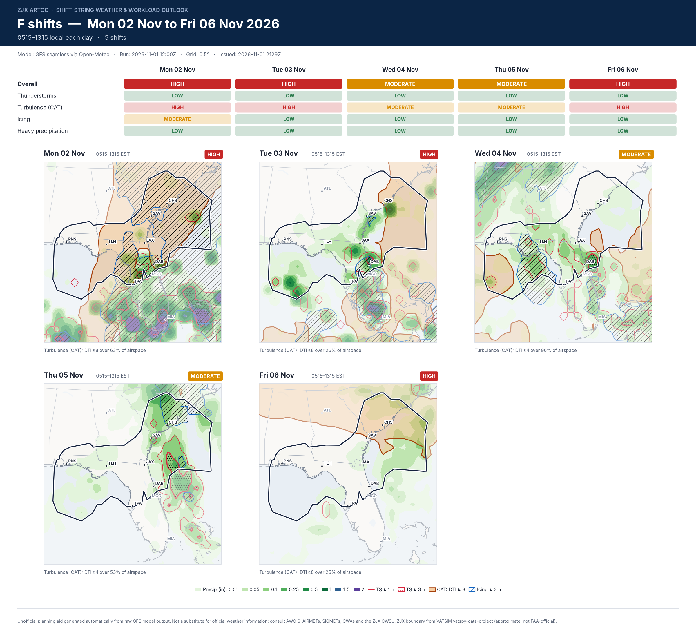
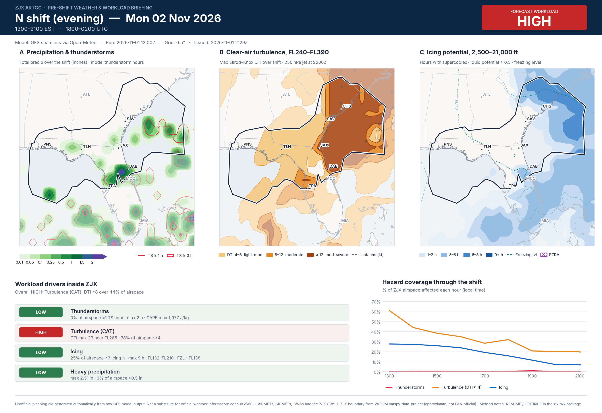
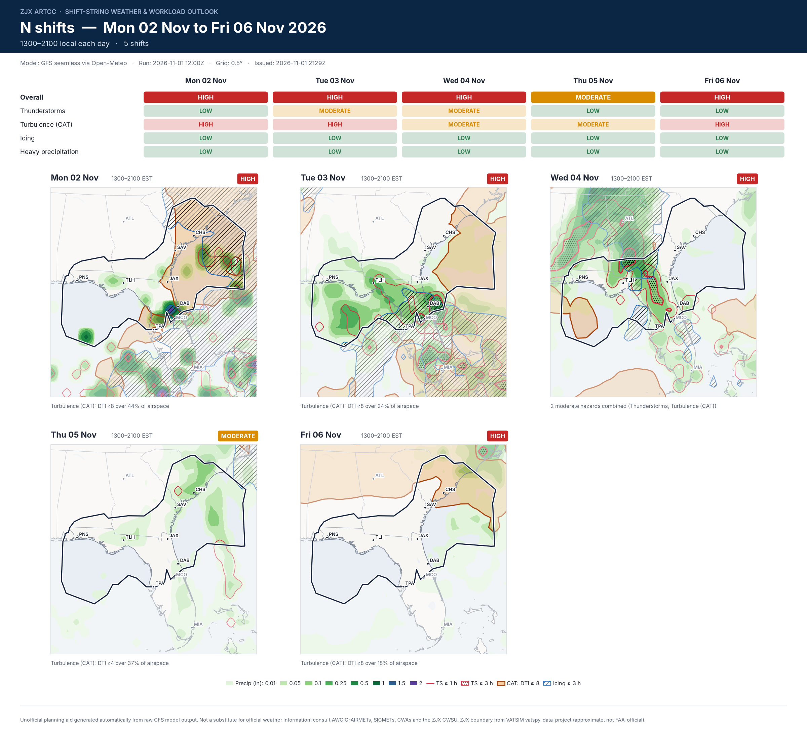

# ZJX pre-shift weather & workload briefings

Latest images: see the GitHub Pages site. Updated 2026-11-01 2129Z.

## F shift, 2026-11-02: **HIGH**

Turbulence (CAT): DTI ≥8 over 63% of airspace

## N shift, 2026-11-02: **HIGH**

Turbulence (CAT): DTI ≥8 over 44% of airspace

