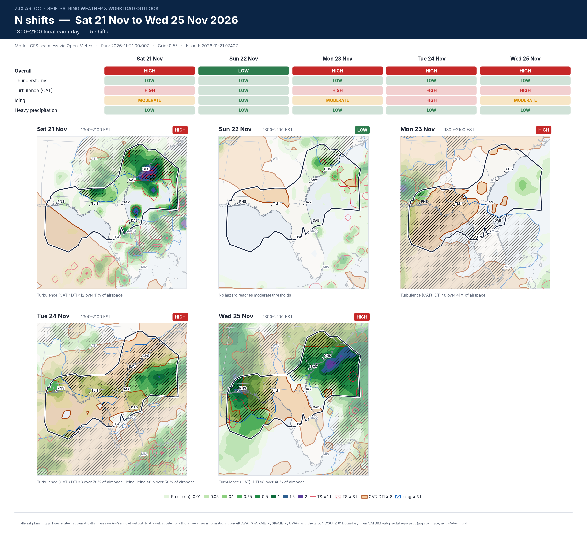
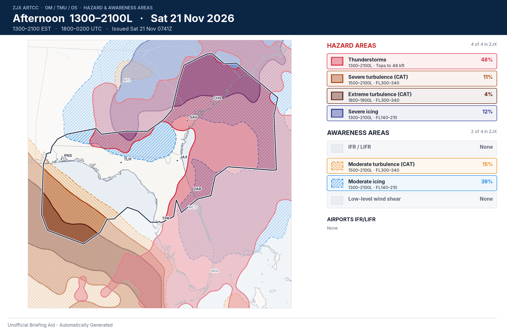

# ZJX pre-shift weather & workload briefings

Latest images: see the GitHub Pages site. Updated 2026-11-21 0741Z.

## F shift, 2026-11-21: **MODERATE**

Icing: icing ≥3 h over 48% of airspace

## N shift, 2026-11-21: **HIGH**

Turbulence (CAT): DTI ≥12 over 11% of airspace

## OM/TMU/OS

### Morning 0500–1300 EST

Hazard: Thunderstorms, Severe icing  
Awareness: Moderate turbulence (CAT), Moderate icing, Low-level wind shear

### Afternoon 1300–2100 EST

Hazard: Thunderstorms, Severe turbulence (CAT), Extreme turbulence (CAT), Severe icing  
Awareness: Moderate turbulence (CAT), Moderate icing

### Overnight 2100–0500 EST

Hazard: Thunderstorms, Severe turbulence (CAT), Severe icing  
Awareness: Moderate turbulence (CAT), Moderate icing

