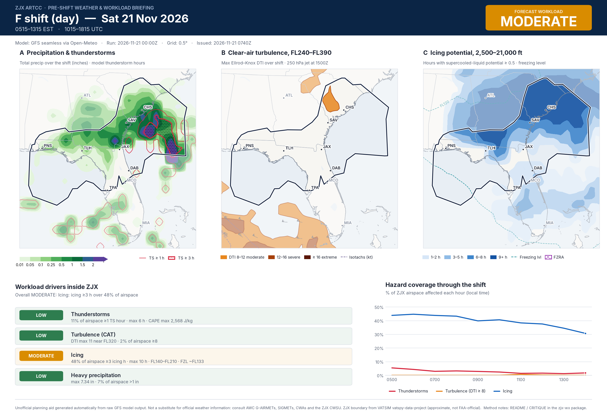
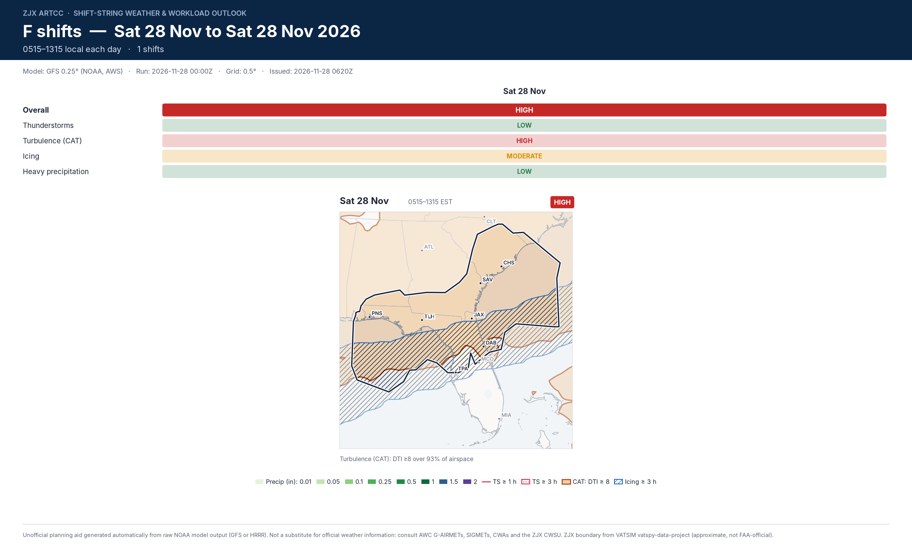
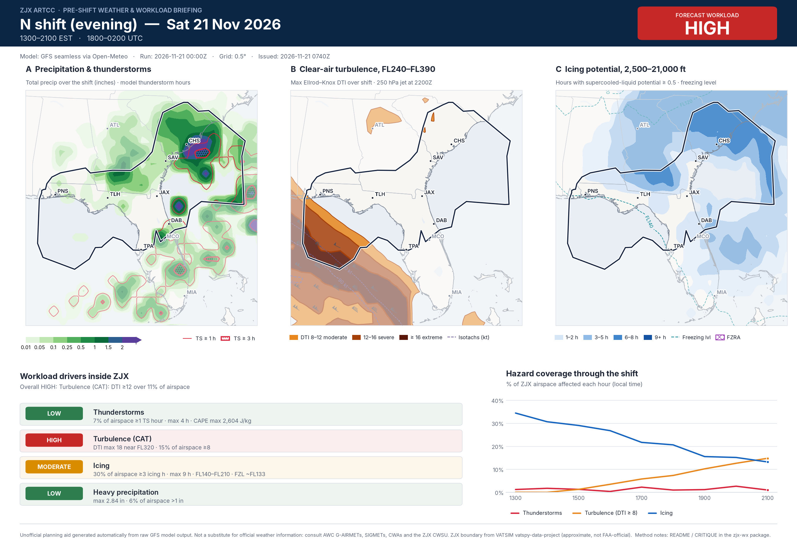
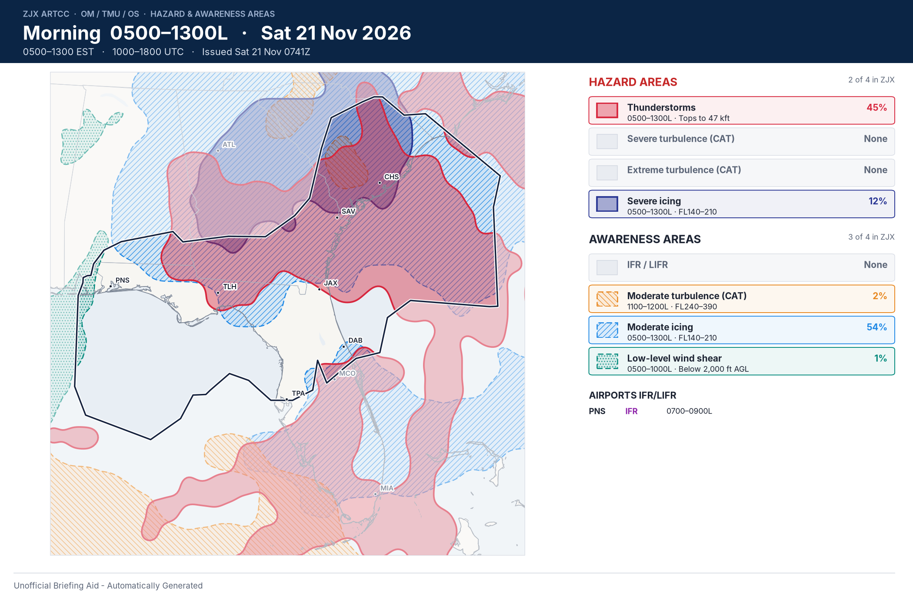
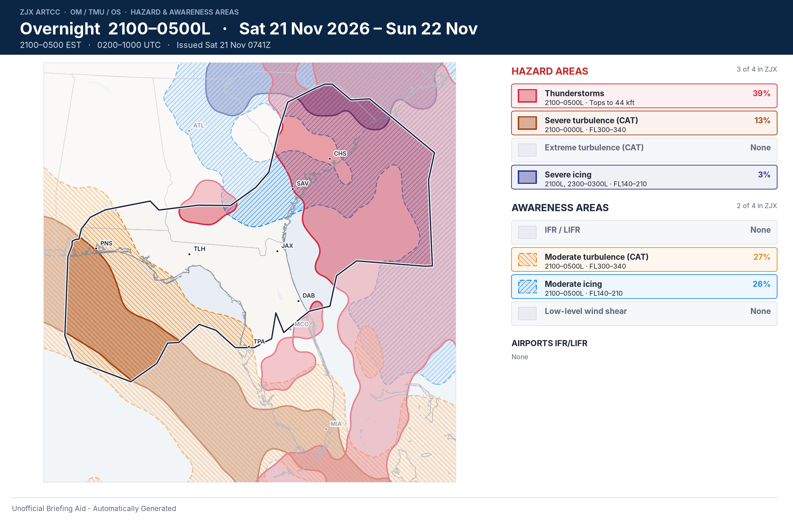

# ZJX pre-shift weather & workload briefings

Latest images: see the GitHub Pages site. Updated 2026-11-28 0620Z.

## F shift, 2026-11-28: **HIGH**

Turbulence (CAT): DTI ≥8 over 93% of airspace

## N shift, 2026-11-28: **HIGH**

Turbulence (CAT): DTI ≥8 over 72% of airspace

## OM/TMU/OS

### Morning 0500–1300 EST

Hazard: Severe turbulence (CAT), Extreme turbulence (CAT), Severe icing  
Awareness: IFR / LIFR, Moderate turbulence (CAT), Moderate icing

### Afternoon 1300–2100 EST

Hazard: Severe turbulence (CAT), Extreme turbulence (CAT), Severe icing  
Awareness: IFR / LIFR, Moderate turbulence (CAT), Moderate icing

### Overnight 2100–0500 EST

Hazard: Severe turbulence (CAT), Extreme turbulence (CAT), Severe icing  
Awareness: IFR / LIFR, Moderate turbulence (CAT), Moderate icing

